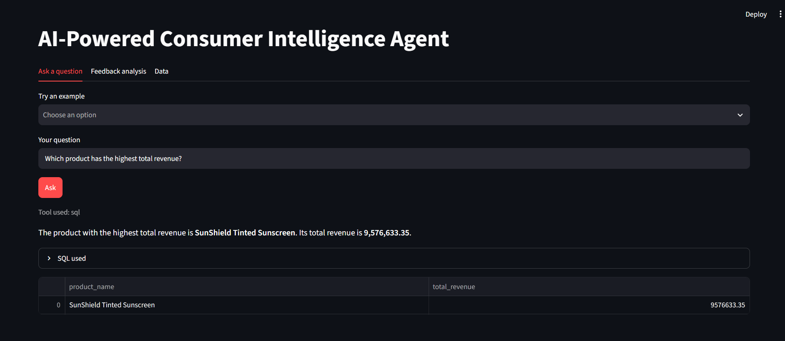
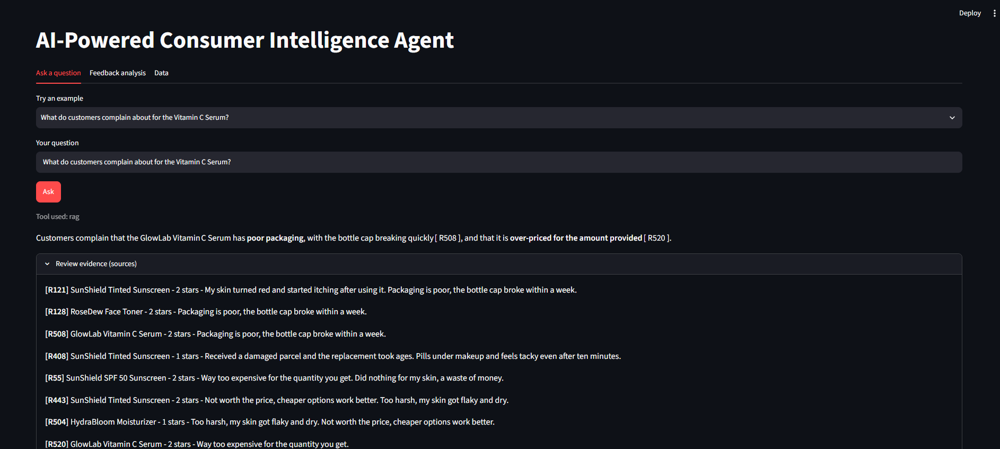
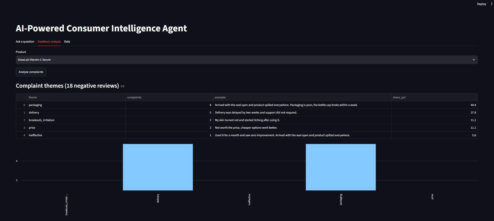
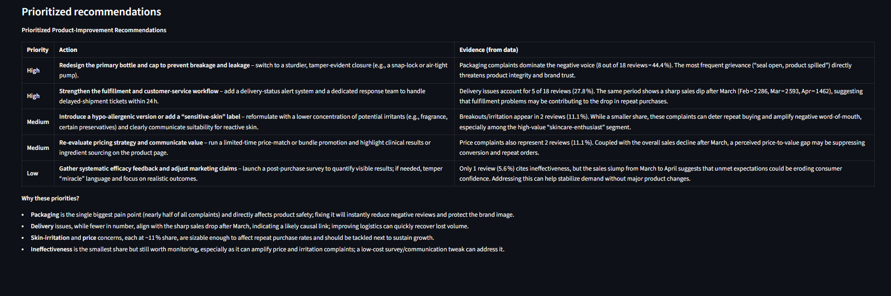

# AI-Powered Consumer Intelligence & Business Analytics Agent

An LLM assistant that answers business questions about skincare sales and customer reviews.

- **RAG over reviews:** reviews are embedded into ChromaDB; answers cite the review ids they used.
- **Natural-language-to-SQL:** questions about revenue, units, ratings are turned into SQL, checked for safety, and run on a read-only SQLite database.
- **Router agent:** decides whether a question needs SQL, RAG, or both.
- **Feedback agent:** classifies complaints into themes, then writes prioritized product recommendations.
- **Streamlit UI** and an **evaluation script** that measures text-to-SQL accuracy.

The data is synthetic (generated by `generate_data.py`) with planted patterns, so you can check the answers.

## Run it

```bash
python -m venv venv
venv\Scripts\activate            # Windows   (Mac/Linux: source venv/bin/activate)
pip install -r requirements.txt

# create a file named .env containing your free Groq key (https://console.groq.com):
# GROQ_API_KEY=your_key_here

python generate_data.py          # creates the CSVs
python ingest.py                 # builds SQLite + ChromaDB (first run downloads a small embedding model)
streamlit run app.py             # opens the app
python eval.py                   # prints text-to-SQL accuracy
```

## How it works

```
question -> router -> SQL tool  (schema + exact values in prompt -> safety check -> read-only run)
                   -> RAG tool  (ChromaDB similarity search -> answer with [R12] citations)
                   -> both      (answers combined)

product -> negative reviews -> LLM labels each with a theme -> counts -> recommendations
```

## Planted patterns to check against

- GlowLab Vitamin C Serum: packaging (leak) complaints dominate; sales drop from April.
- SunShield SPF 50 Sunscreen: texture (sticky, white cast) complaints dominate.
- SunShield Tinted Sunscreen: sales grow every month.

## Results

Text-to-SQL evaluation (10 questions): 10/10 correct answers (5/10 identical to reference output; the rest returned the right answer plus extra columns). Unsafe queries blocked: 6/6.

   
   
   
   